# Báo cáo Bài thực hành 2 – Student Deadline Tracker (nâng cấp)

> Mọi số liệu & ảnh trong báo cáo được sinh **tự động** bằng [`scripts/measure.mjs`](../scripts/measure.mjs) và [`scripts/collect.mjs`](../scripts/collect.mjs) (Chrome headless qua Puppeteer + Lighthouse CLI 12.8.2), dữ liệu thô ở `docs/measure-results.json`, `docs/lighthouse-*.report.html|json`.
>
> **Lưu ý trung thực:** ảnh "Console" ở mục A.3 là ảnh *dựng lại* từ log redux-logger thật mà Puppeteer bắt được (không phải ảnh chụp cửa sổ F12). Nếu giảng viên yêu cầu ảnh F12 gốc, hãy chạy `npm run dev`, mở F12 → Console và thao tác tương tự để chụp thêm.

---

## Phần A – Quản lý state

### A.1 Ghim bài tập bằng Zustand
- File: [`usePinStore.ts`](../src/features/pins/usePinStore.ts) – `pinnedIds`, `togglePin(id)`, `isPinned(id)`. Không dùng Redux.
- `AssignmentList` đưa bài đã ghim lên đầu (`useMemo`), `AssignmentCard` dùng selector hẹp nên chỉ card bị ghim mới render lại.
- Kết quả thực nghiệm: card đầu tiên trước khi ghim là *"Cấu trúc dữ liệu & Giải thuật – Bài tập cây AVL"*, sau khi ghim bài cuối danh sách → card đầu tiên là *"Chủ nghĩa xã hội khoa học – Tiểu luận cuối…"*.

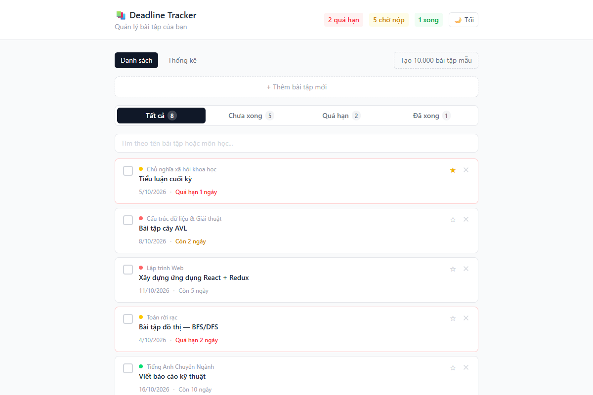

### A.2 Theme Context (sáng/tối)
- File: [`ThemeContext.tsx`](../src/context/ThemeContext.tsx) – Context riêng, `value` bọc `useMemo`, `toggleTheme` bọc `useCallback`. Chỉ `ThemeToggle` (memo) consume context.
- **Xác nhận không re-render component không liên quan:** thay vì Profiler bằng mắt, tôi gắn bộ đếm `window.__cardRenders` vào `AssignmentCard`, reset về 0, bấm đổi theme → **số lần render AssignmentCard = 0**.
  (Cách tự kiểm chứng bằng React DevTools Profiler: Profiler → Record → bấm "🌙 Tối" → Stop; các card hiển thị "Did not render".)

| Light | Dark |
|---|---|
| 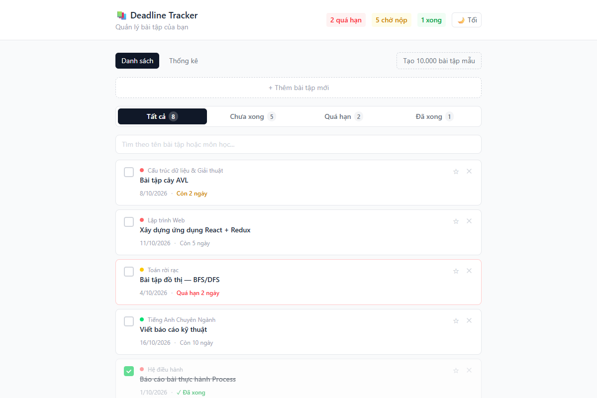 | 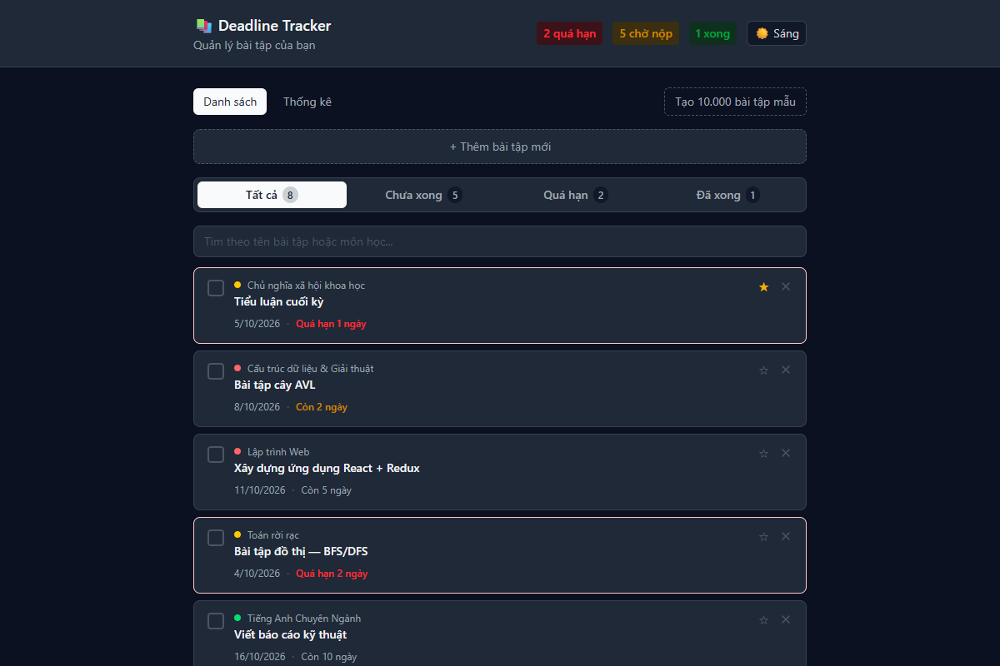 |

### A.3 Redux middleware – redux-logger (chỉ dev)
- [`store.ts`](../src/store/store.ts): logger chỉ thêm khi `import.meta.env.DEV`; với danh sách > 100 mục chỉ log tóm tắt để không làm chậm.

**Thêm bài tập** – action `assignments/addAssignment`
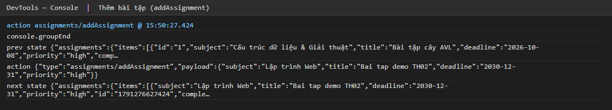

**Hoàn thành bài tập** – action `assignments/toggleComplete`
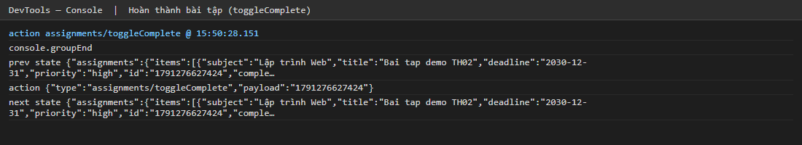

**Xoá bài tập** – action `assignments/deleteAssignment`
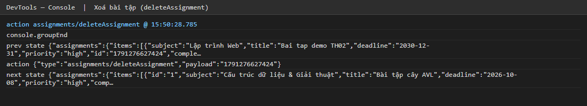

Ảnh giao diện tương ứng: [form](images/02a-add-form.png) · [sau khi thêm](images/02b-after-add.png) · [sau khi hoàn thành](images/04a-after-complete.png) · [sau khi xoá](images/05a-after-delete.png)

---

## Phần B – Tối ưu hiệu năng

### B.1 Chế độ stress test
Nút **"Tạo 10.000 bài tập mẫu"** ([`StressTestButton.tsx`](../src/components/StressTestButton.tsx)) dùng `generateSampleAssignments(10000)`.

### B.2 Cách đo
- **Trước tối ưu:** mở `/?perf=baseline` – tắt `React.memo`, tắt debounce (0 ms), tắt virtualization (render đủ 10.000 card). Cùng một bản build, chỉ khác công tắc ([`perfMode.ts`](../src/perfMode.ts)).
- **Sau tối ưu:** mở `/` (mặc định).
- **Số lần render `AssignmentCard`:** bộ đếm `window.__cardRenders` (tương đương cột "render count" của Profiler). Kịch bản: bấm nút 10.000 bài → reset bộ đếm → gõ `123` vào ô tìm kiếm (150 ms/ký tự) → chờ ổn định.
- **Lighthouse:** `npm run build` + `vite preview`, trang `/?seed=10000` (nạp sẵn 10.000 bài vì Lighthouse không bấm nút được), chỉ category Performance, mặc định mobile + throttling.

| Trước tối ưu (`?perf=baseline`) | Sau tối ưu |
|---|---|
| 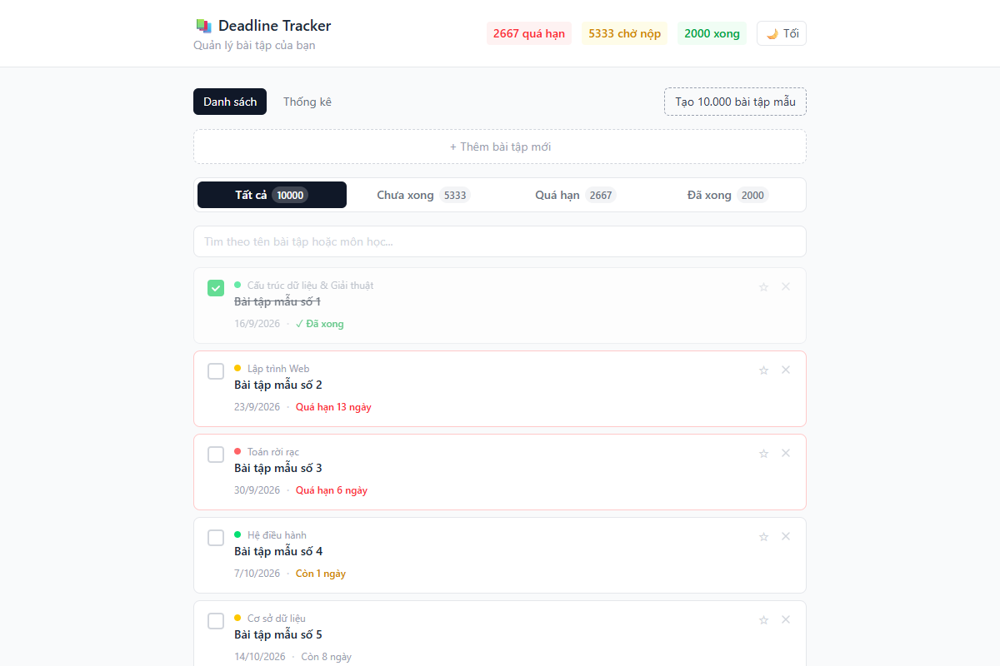 | 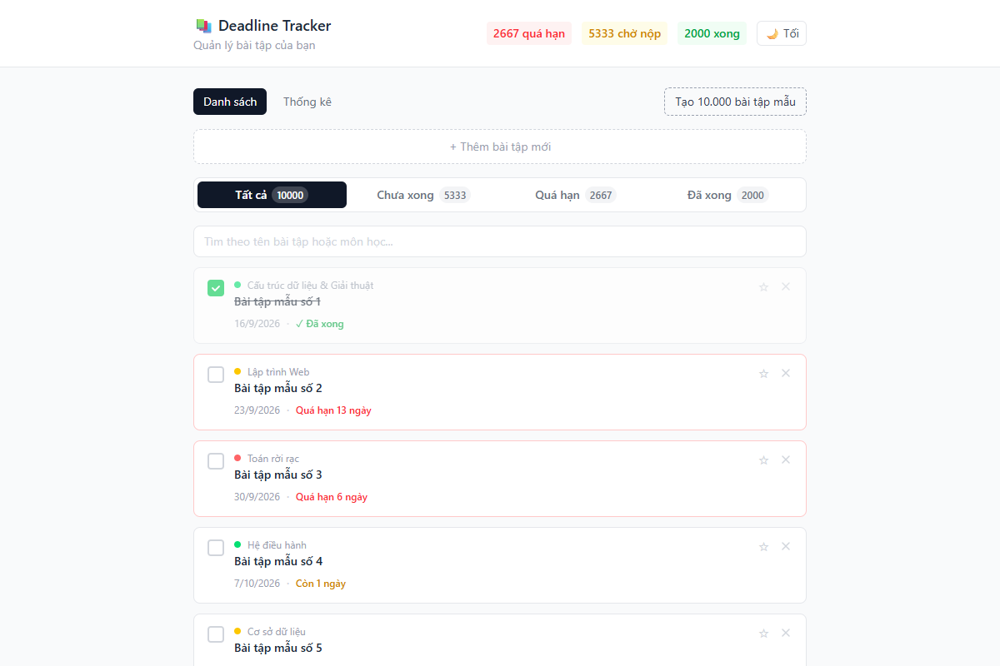 |
|  | 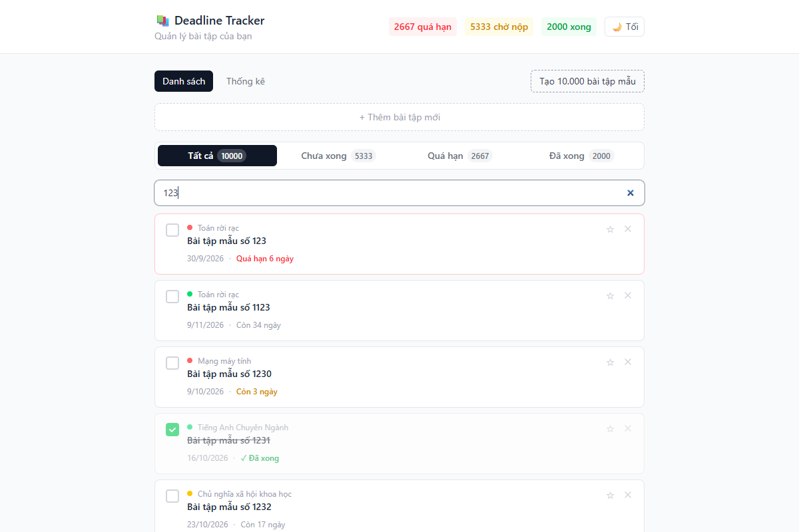 |

### B.3 4 kỹ thuật đã áp dụng
| # | Kỹ thuật | Vị trí | Lý do dùng đúng chỗ |
|---|---|---|---|
| 1 | `React.memo` + `useCallback` | [`AssignmentCard`](../src/components/AssignmentCard.tsx), `handleToggle/handleDelete` trong [`AssignmentList`](../src/components/AssignmentList.tsx) | Card render hàng nghìn lần; props ổn định nên memo thực sự có tác dụng |
| 2 | `useDebounce(300ms)` + `useMemo` | ô tìm kiếm + bước lọc / đưa bài ghim lên đầu | Lọc 10.000 phần tử không nên chạy mỗi phím gõ |
| 3 | Virtualization `react-window` | `AssignmentList` (chỉ khi > 100 mục) | Danh sách nhỏ render thường cho đơn giản, tránh lạm dụng |
| 4 | `React.lazy` + `Suspense` | trang [Thống kê](../src/components/StatsPage.tsx) | Chunk riêng, chỉ tải khi mở tab |

Bằng chứng lazy: build tạo chunk riêng `StatsPage-*.js` (1.58 kB) và khi mở tab Thống kê trình duyệt mới request `src/components/StatsPage.tsx`.
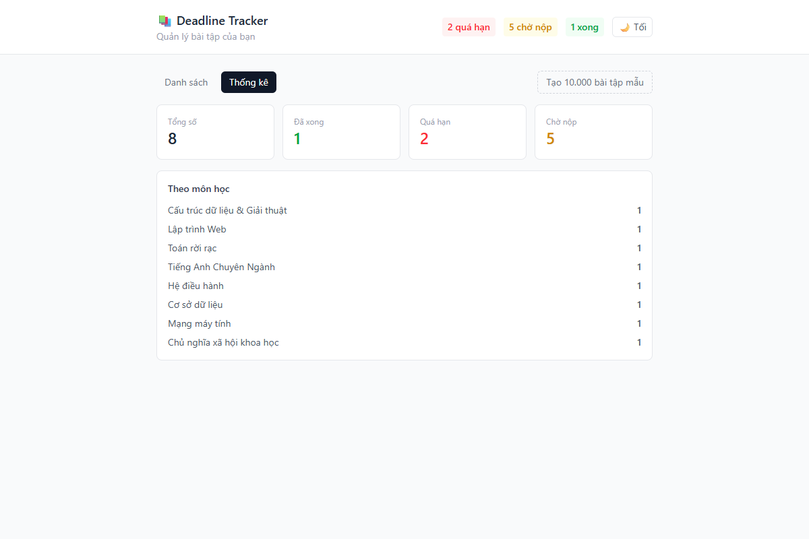

### B.4 Bảng so sánh trước / sau (10.000 bài tập)

| Chỉ số | Trước | Sau | Cải thiện |
|---|---|---|---|
| Số lần render `AssignmentCard` khi gõ `123` | **34.996** | **40** | giảm ~99,9% |
| Số `AssignmentCard` trong DOM sau khi tạo 10.000 bài | 10.000 | 9 | giảm ~99,9% |
| Thời gian từ lúc bấm nút đến khi hiển thị danh sách | 2.606 ms | 200 ms | ~13× nhanh hơn |
| Thời gian gõ 3 ký tự + chờ ổn định (có chờ cố định) | 5.353 ms | 1.514 ms | ~3,5× |
| **Lighthouse Performance** | **67** | **97** | +30 điểm |
| Total Blocking Time | 2.460 ms | 140 ms | giảm ~94% |
| Largest Contentful Paint | 2,3 s | 1,9 s | |
| Speed Index | 4,0 s | 2,7 s | |
| First Contentful Paint | 1,8 s | 1,8 s | không đổi |
| Cumulative Layout Shift | 0 | 0 | |
| DOM size (Lighthouse) | 154.031 phần tử | 180 phần tử | giảm ~99,9% |

Báo cáo Lighthouse đầy đủ: [trước](lighthouse-baseline.report.html) · [sau](lighthouse-optimized.report.html)

| Lighthouse – trước | Lighthouse – sau |
|---|---|
| 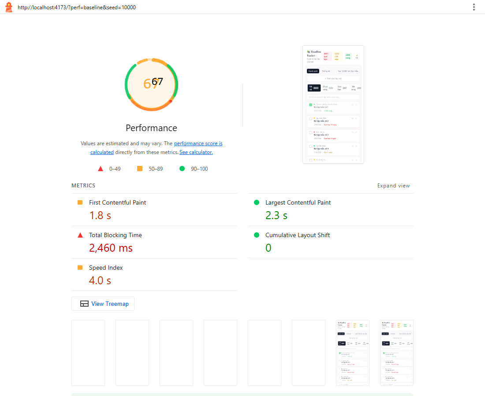 | 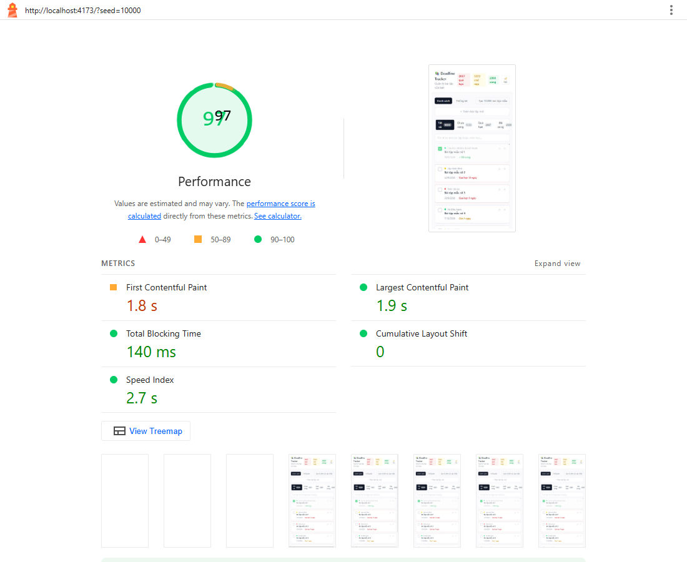 |

> Số đo thay đổi theo máy/lần chạy (Lighthouse là ước lượng); xu hướng mới là điều quan trọng. Thời gian "gõ + chờ" trong bảng gồm khoảng chờ cố định của script (3 s baseline, 1 s optimized) nên chỉ mang tính tham khảo.

---

## Phần C – Kiểm thử

### C.1 Cấu hình
- [`jest.config.ts`](../jest.config.ts): `ts-jest` (preset), môi trường `jsdom`, `setupFilesAfterEnv` = [`src/setupTests.ts`](../src/setupTests.ts) (jest-dom), tsconfig riêng [`tsconfig.jest.json`](../tsconfig.jest.json).
- `collectCoverageFrom: src/features/**` và `coverageThreshold` (statements ≥ 70% cho `./src/features/` và global).
- Công cụ: Jest 29, ts-jest, @testing-library/react, user-event, jest-dom.
- Lệnh: `npm test` · `npm run test:coverage`.

### C.2 Kết quả: **6 suite, 31 test, tất cả PASS** (yêu cầu tối thiểu 12)
Số liệu coverage cho `features/`: **89,24% statements** (ngưỡng 70%).

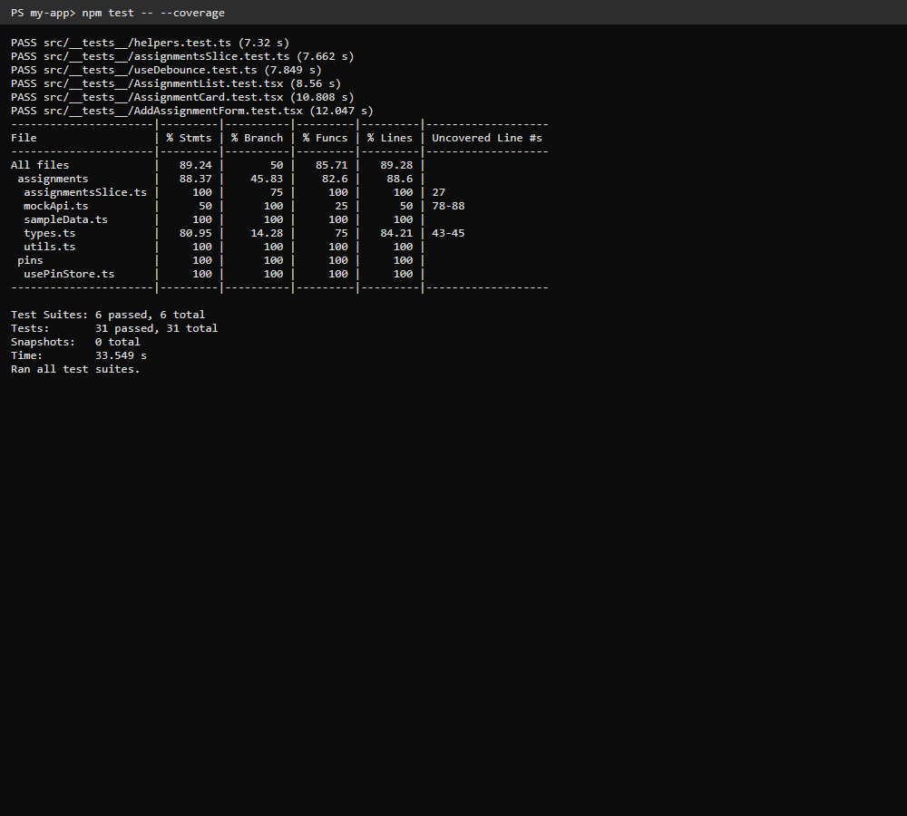
Log đầy đủ: [`jest-output.txt`](jest-output.txt)

| Loại | File test (`src/__tests__/`) | Nội dung | Yêu cầu | Thực tế |
|---|---|---|---|---|
| Unit | `helpers.test.ts` | `isOverdue`, `calcDaysLeft`, `calcStats`, generator – kể cả trường hợp biên (rỗng, hôm nay, quá hạn đã hoàn thành…) | ≥ 5 | ✔ (cùng reducer) |
| Unit | `assignmentsSlice.test.ts` | reducer add / toggle / delete / setFilter / setAssignments / fetch pending-fulfilled-rejected, id không tồn tại | | ✔ |
| Component | `AssignmentCard.test.tsx` | hiển thị, nút hoàn thành, nút ghim (userEvent) | ≥ 4 (cùng form) | ✔ |
| Component | `AddAssignmentForm.test.tsx` | validate tên rỗng, submit thành công | | ✔ |
| Bất đồng bộ | `AssignmentList.test.tsx` | API mock: đang tải, thành công, lỗi | ≥ 2 | ✔ (3) |
| Hook | `useDebounce.test.ts` | `renderHook` + fake timers | ≥ 1 | ✔ |

Kiểm tra bổ sung: `npx tsc -b` không lỗi; `eslint` đã xử lý.

---

## Cách chạy lại
```bash
npm install
npm run dev                 # có redux-logger (dev)
npm test                    # 31 test
npm run test:coverage       # coverage + ngưỡng 70%
node scripts/measure.mjs    # đo render count + chụp ảnh (cần dev server :5173)
npm run build && npx vite preview --port 4173   # Lighthouse
```
Chế độ đo: `/?perf=baseline` (trước tối ưu), `/?seed=10000` (nạp sẵn 10.000 bài).

## Nộp bài
Repo GitHub `<Mã SV>_LTWNC_TH02`; nếu private, mời `nvnhan`.
